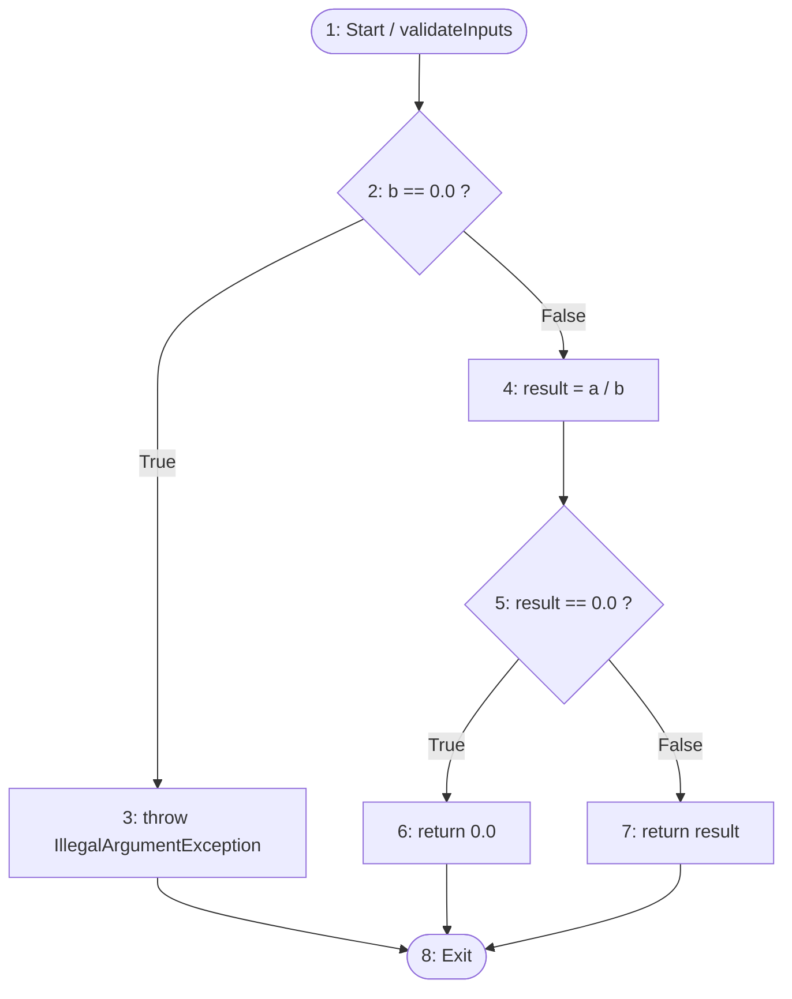
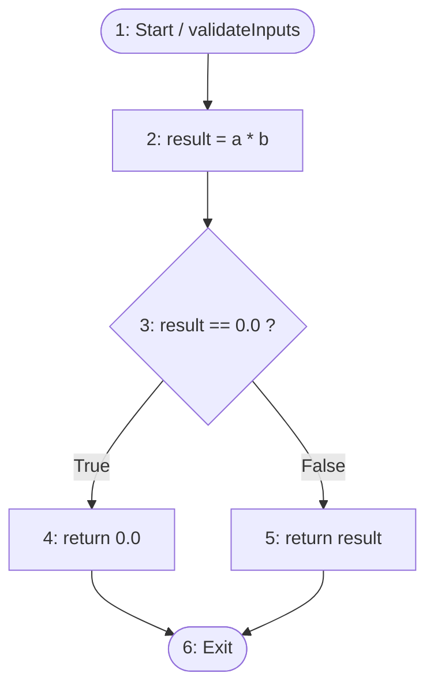
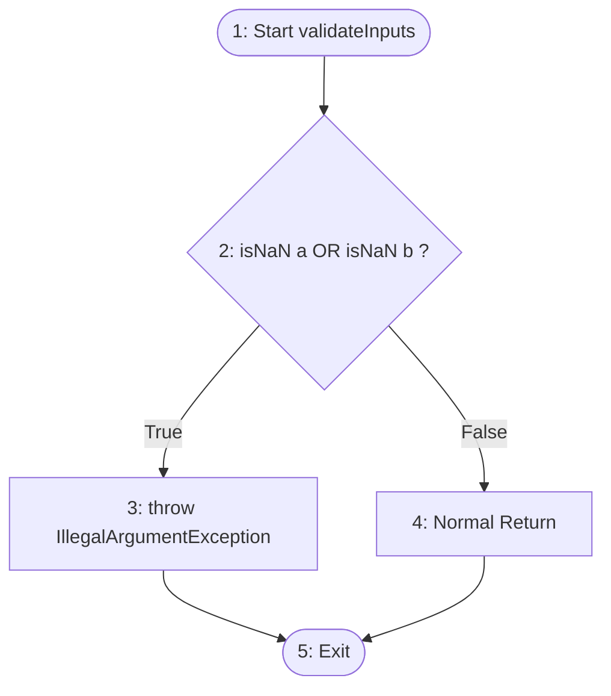
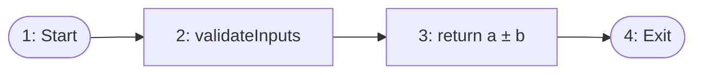
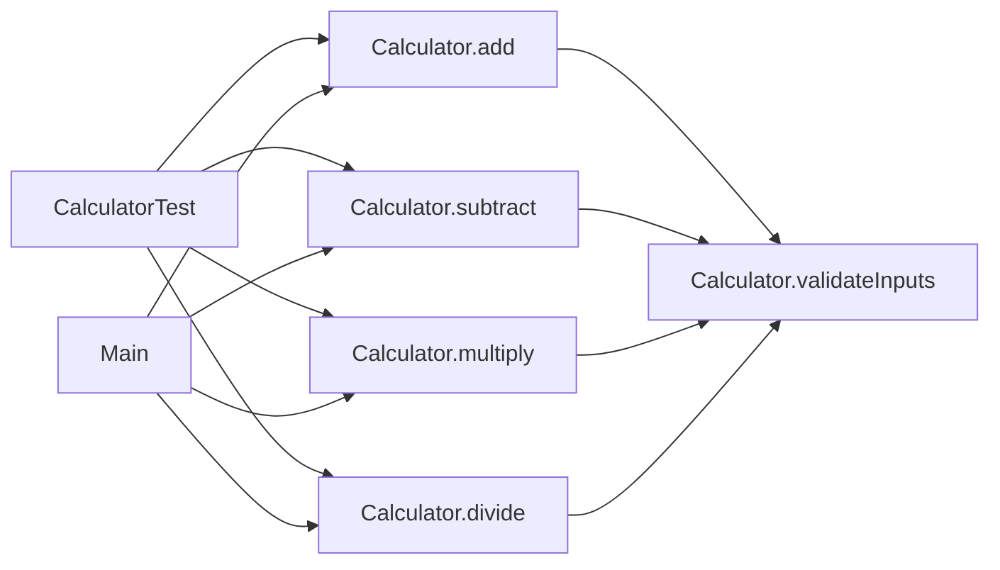

# پروژه درس تست نرم‌افزار: ماشین حساب ۴ عمل اصلی (Java + JUnit 5)

## ۱. ساختار پروژه (بدون پوشه‌های اضافه)
- `pom.xml`: تنظیمات Maven و وابستگی JUnit 5
- `src/main/java/Calculator.java`: منطق اصلی ماشین حساب
- `src/main/java/Main.java`: رابط کاربری کنسول
- `src/test/java/CalculatorTest.java`: مجموعه ۱۹ تست واحد با JUnit 5

---

## ۲. گراف‌های جریان کنترل (Control Flow Graphs - White-Box Testing)

### الف) گراف جریان کنترل متد `divide(double a, double b)`
پیچیدگی سیکلوماتیک مک‌کیب: $V(G) = E - N + 2 = 9 - 8 + 2 = 3$

**مسیرهای مستقل (Basis Paths):**
1. **مسیر ۱ (تقسیم بر صفر):** `1 → 2 → 3 → 8` (تست‌شده در `testDivisionByZeroThrowsException`)
2. **مسیر ۲ (صورت صفر):** `1 → 2 → 4 → 5 → 6 → 8` (تست‌شده در `divide(0, -5)`)
3. **مسیر ۳ (تقسیم عادی):** `1 → 2 → 4 → 5 → 7 → 8` (تست‌شده در `divide(10, 5)`)

---

### ب) گراف جریان کنترل متد `multiply(double a, double b)`
پیچیدگی سیکلوماتیک: $V(G) = 6 - 6 + 2 = 2$

---

### ج) گراف جریان کنترل متد `validateInputs(double a, double b)`
پیچیدگی سیکلوماتیک: $V(G) = 5 - 5 + 2 = 2$

---

### د) گراف جریان کنترل متدهای خطی (`add` و `subtract`)
پیچیدگی سیکلوماتیک: $V(G) = 3 - 4 + 2 = 1$

---

## ۳. گراف فراخوانی پروژه (Call Graph)

## ۴. دستورات اجرا
- اجرای تست‌ها: `mvn test`
- اجرای برنامه: `mvn compile exec:java -Dexec.mainClass="Main"`
